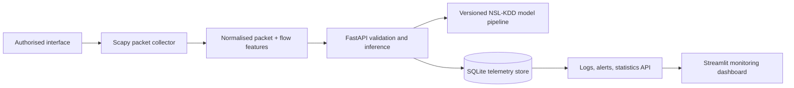

# Real-Time Cyber Threat Detection Using Machine Learning and Network Traffic Analysis

> A research-oriented intrusion-detection prototype that connects authorised
> live packet observation, NSL-KDD machine learning, validated APIs,
> persistent telemetry, severity-aware alerts, and a presentation-ready
> monitoring dashboard.

## Why this is more than a classifier demo

The system keeps data collection, feature engineering, inference, persistence,
and visualisation separate. A Scapy sensor observes IPv4 traffic and sends a
normalised packet/flow event to FastAPI. The API maps that event to the
NSL-KDD feature contract, invokes a versioned model pipeline, records an
auditable decision in SQLite, and creates an alert only for model-classified
threats. Streamlit reads the API rather than the database directly.



## Project structure

```text
ai_model/
  schema.py             # Canonical NSL-KDD schema and live-feature bridge
  model.py              # Training, comparison, evaluation, artifact creation
  inference.py          # Safe versioned-artifact inference adapter
  KDDTrain+.txt         # Supplied NSL-KDD training partition
  artifacts/            # Generated model, metrics, report, confusion matrix
backend_api/
  main.py               # FastAPI endpoints and service lifecycle
  schemas.py            # Validated Pydantic request/response contracts
  storage.py            # SQLite traffic and alert repository
  config.py             # Environment-based settings
network_sniffer/
  sniffer.py            # Privilege-aware Scapy capture CLI
  features.py           # Packet extraction and bounded flow accounting
  client.py             # Resilient API delivery client
frontend_ui/
  app.py                # Streamlit monitoring and historical analytics view
project_report/
  REPORT.md             # Research-report structure and methodology
  PRESENTATION_GUIDE.md # Demo narrative and viva talking points
```

## NSL-KDD research foundation

NSL-KDD refines the KDD Cup 1999 intrusion-detection data by reducing record
redundancy. Each connection has 41 predictor fields, an attack label, and a
difficulty value. The supplied `KDDTrain+.txt` is parsed with its canonical
schema, while the difficulty field is excluded from model inputs.

The default experiment converts labels to **normal** versus **attack** for a
deployable binary classifier. A `--target family` option groups attacks into
DoS, Probe, R2L, and U2R. Preprocessing is fitted only on the training split:
numeric columns are imputed/scaled, protocol/service/flag categories are
encoded with an unknown-safe one-hot encoder, and a supervised F-statistic
selector retains the configured strongest transformed features. This entire
pipeline is saved with the model so the API cannot accidentally reorder live
features or repeat feature selection on an evaluation set.

The current repository contains `KDDTrain+`, so its built-in evaluation is a
stratified internal hold-out experiment. For an independent benchmark claim,
obtain the official `KDDTest+` file and supply it with `--test-path`. Do not
present a random split of `KDDTrain+` as external test performance.

## Quick start

### 1. Install

Use Python 3.10+ in a virtual environment. From the repository root:

```powershell
python -m venv .venv
.\.venv\Scripts\Activate.ps1
python -m pip install --upgrade pip
python -m pip install -r requirements.txt
```

Install the optional XGBoost comparison model when required:

```powershell
python -m pip install -r requirements-research.txt
```

Create local configuration (the application loads `.env` automatically):

```powershell
Copy-Item .env.example .env
```

All defaults are local; no computer-specific address, MAC address, or
credential is embedded in source code.

### 2. Train and evaluate the model

Run the complete comparison against the supplied data:

```powershell
python -m ai_model.model
```

For a quicker classroom smoke run, use a reproducible subset and selected
baselines:

```powershell
python -m ai_model.model --max-rows 15000 --models decision_tree,random_forest,logistic_regression,linear_svm
```

To evaluate the final selected model against an official external NSL-KDD
partition after downloading it separately:

```powershell
python -m ai_model.model --test-path path\to\KDDTest+.txt
```

The command writes the deployable artifact to
`ai_model/artifacts/intrusion_detection_model.joblib` and creates:

- `model_metadata.json` (version, data split, chosen model, metrics);
- `model_comparison.csv` (training and hold-out comparison);
- `classification_report.json`; and
- `confusion_matrix.png` when Matplotlib is available.

Model selection prioritises hold-out F1 score and reports accuracy, precision,
recall, F1, ROC-AUC where supported, a full classification report, confusion
matrix, and train-versus-test behaviour. The compared estimators are Decision
Tree, Random Forest, Logistic Regression, Linear SVM, and XGBoost when the
optional package is installed.

### 3. Start the API

```powershell
uvicorn backend_api.main:app --host 127.0.0.1 --port 8000 --reload
```

Open [API documentation](http://127.0.0.1:8000/docs). The API starts even
before training, but reports `model_loaded: false` rather than fabricating a
heuristic threat decision. Train the versioned artifact before a live demo.

### 4. Start the dashboard

In a second terminal:

```powershell
streamlit run frontend_ui/app.py
```

The dashboard exposes packet/threat/normal totals, protocol and severity
trends, recent decision logs, suspicious sources, alert history, and deployed
model metadata. It remains readable while the backend is offline and uses the
`THREAT_API_URL` environment variable when the API is hosted elsewhere.

### 5. Run an authorised packet capture

First inspect the effective collector settings:

```powershell
python -m network_sniffer.sniffer --print-config
```

Then capture a small demo sample:

```powershell
python -m network_sniffer.sniffer --count 25
```

On Windows, Scapy commonly requires [Npcap](https://npcap.com/) and an
elevated PowerShell session. On Linux/macOS, capture often needs `sudo` or
capabilities. Capture only networks/interfaces that you are explicitly
authorised to monitor. Use `--no-forward` for a capture-only extraction demo.

## API overview

| Endpoint | Purpose |
| --- | --- |
| `GET /health` | API/database readiness and model availability |
| `GET /model/status` | Model version, class labels, and saved evaluation evidence |
| `POST /analyze` | Validate, classify, persist, and potentially alert on one event |
| `GET /logs` | Paginated persistent traffic decisions |
| `GET /alerts` | Paginated alerts, filterable by severity/status |
| `GET /statistics` | Dashboard totals, protocol trends, severity mix, suspicious IPs |

Versioned aliases are also provided under `/api/v1/`; the collector uses
`POST /api/v1/packets/analyze` by default.

Example request (PowerShell):

```powershell
$event = @{
  source_ip = "192.0.2.10"; destination_ip = "198.51.100.20";
  protocol = "TCP"; source_port = 49152; destination_port = 443;
  packet_size = 512; tcp_flags = "S"; flow_packet_count = 1;
  flow_byte_count = 512; flow_duration_seconds = 0.0;
  packets_per_second = 1.0; bytes_per_second = 512.0;
  anomaly_indicators = @("tcp_syn_without_ack")
} | ConvertTo-Json
Invoke-RestMethod -Method Post -Uri "http://127.0.0.1:8000/analyze" -ContentType "application/json" -Body $event
```

## Configuration

Copy `.env.example` to `.env` and alter only the values appropriate for your
authorised lab. The most relevant variables are:

| Variable family | Examples | Responsibility |
| --- | --- | --- |
| `CTD_*` | `CTD_MODEL_PATH`, `CTD_DATABASE_PATH`, `CTD_MAX_LOG_RECORDS` | FastAPI model/storage settings |
| `CYBER_*` | `CYBER_API_URL`, `CYBER_SNIFFER_INTERFACE`, `CYBER_PACKET_LIMIT` | Scapy capture/delivery settings |
| `THREAT_API_URL` | `http://127.0.0.1:8000` | Streamlit API base URL |

See the [sniffer README](network_sniffer/README.md) and [API guide](backend_api/API_GUIDE.md)
for the complete component contracts and configuration tables.

## Academic strengths and limitations

This project is intentionally explicit about its scientific boundaries:

- it compares several models under a reproducible seed rather than claiming a
  hand-picked accuracy;
- it stores preprocessing with the model to prevent training-serving skew;
- it reports false-positive/false-negative trade-offs through precision,
  recall, F1, ROC-AUC, and a confusion matrix;
- it keeps SQLite telemetry and severity-labelled alerts for a traceable demo;
- it acknowledges that NSL-KDD represents historical **connection** records,
  while live capture begins as packets; a feature-quality indicator makes this
  gap visible; and
- it treats ML output as analyst decision support, not a license to block
  traffic automatically.

See [the formal report](project_report/REPORT.md) and
[presentation guide](project_report/PRESENTATION_GUIDE.md) for the report
structure, methodology, ethics, research narrative, and viva preparation.

## Security and privacy

This is an educational and research prototype. Protect local SQLite telemetry,
restrict API exposure, use HTTPS/authentication before any non-local
deployment, and comply with campus/company policy and applicable law. Do not
capture traffic from networks you do not own or lack written permission to
monitor.
