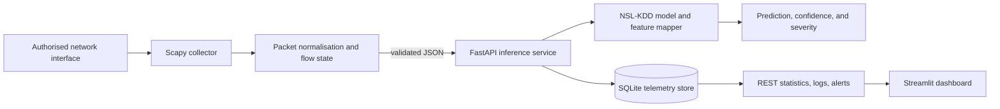

# Real-Time Cyber Threat Detection Using Machine Learning and Network Traffic Analysis

## Abstract

Enterprise and campus networks generate more traffic than a human analyst can
review in real time. This project presents a lightweight intrusion-detection
prototype that combines live packet capture, flow-aware feature extraction,
machine-learning classification, structured alerting, durable telemetry, and a
web monitoring dashboard. The classifier is trained reproducibly on the
NSL-KDD benchmark. A FastAPI service makes inference and security events
available through validated interfaces, while a Scapy collector sends only
normalised metadata to the service. The design prioritises explainability,
repeatability, and a credible boundary between a research benchmark and live
network observations. It is intended as decision support: an alert invites
investigation and must not autonomously block traffic.

**Keywords:** intrusion detection, NSL-KDD, network traffic analysis, machine
learning, FastAPI, Scapy, real-time monitoring.

## 1. Introduction and Background

Traditional signature-based intrusion-detection systems are effective for
known attacks but may miss novel or obfuscated behaviour. Machine learning can
learn discriminative patterns from labelled traffic features and rank events for
analyst review. The challenge is translating an offline benchmark model into a
defensible near-real-time system: a raw packet is not identical to a complete
network connection, categories must be encoded consistently, and every
decision must be observable and auditable.

This project uses an ML classifier as one component in a monitoring pipeline.
It does not claim to replace a firewall, endpoint detection platform, or a
security operations centre.

## 2. Problem Statement

Small organisations and teaching laboratories often lack a transparent way to
observe network traffic, identify potentially malicious patterns, and preserve
an evidence trail for review. A basic proof of concept that only prints a
prediction is not sufficient for academic validation or operational
demonstration. The problem addressed here is how to construct a modular,
reproducible, and understandable system that converts authorised live traffic
metadata into ML-assisted intrusion alerts and visualises both current and
historical activity.

## 3. Objectives

1. Train and compare classifiers on the NSL-KDD dataset using a reproducible,
   leakage-aware pipeline.
2. Capture authorised IP traffic and normalise packet/flow observations into a
   standard schema.
3. Expose validated inference, event, alert, and summary endpoints through a
   REST API.
4. Persist audit-friendly traffic decisions and visualise them in a modern
   monitoring dashboard.
5. Report metrics, assumptions, and limitations honestly enough for academic
   discussion and future research extension.

## 4. Proposed System and Architecture

The modules communicate through explicit data contracts rather than direct
imports. This separation lets the capture process run with the privileges it
needs while the dashboard remains a low-privilege, read-only client.

## 5. Dataset Description

NSL-KDD is a refined version of the KDD Cup 1999 intrusion-detection dataset,
created to reduce redundant records and make evaluation more meaningful. Each
connection record has 41 traffic features, a class label, and a difficulty
field. The supplied `KDDTrain+.txt` is the project's training source.

Feature families include:

- **Basic connection features:** duration, protocol, service, TCP flag, bytes,
  land indicator, and packet/fragment-related counts.
- **Content features:** failed logins, shell/root activity, file access, and
  related host-content indicators.
- **Time-based traffic features:** counts and rates over a short connection
  window.
- **Host-based traffic features:** destination-host counts and rates over a
  longer history.

Labels include `normal` and attack names that are conventionally grouped as
DoS, Probe, R2L, and U2R. The default deployable experiment frames the task as
binary **normal versus attack** because live single-packet evidence cannot
reliably distinguish every historical attack subtype. The pipeline retains the
option to extend to multiclass classification once evaluation support is added.

**Important validity note:** `KDDTrain+` alone supports a stratified hold-out
experiment, not a fully independent benchmark evaluation. For a reportable
result, obtain the official NSL-KDD `KDDTest+` file, run it through the same
fitted preprocessing pipeline, and report that result separately. Do not
describe a random split from `KDDTrain+` as an external test-set result.

## 6. Methodology

### 6.1 Reproducible data preparation

The training command loads the raw comma-separated NSL-KDD file using the
canonical 41-column schema, discards the difficulty field from predictors,
normalises labels, and splits data with a fixed random seed and stratification.
All learned transformations are fitted on the training partition only.

Categorical fields (`protocol_type`, `service`, `flag`) are encoded with an
unknown-safe one-hot encoder. Numeric fields are imputed and, where required by
the estimator, standardised; a configurable univariate F-statistic
`SelectPercentile` stage performs supervised feature selection. All stages live
inside a scikit-learn `Pipeline`, preventing test-set information from
influencing preprocessing or feature selection. The saved artifact
contains the fitted pipeline, label mapping, feature schema, metadata, and
metric summary together.

### 6.2 Feature engineering for live observations

Scapy provides transport protocol, IP endpoints, ports, packet length, TCP
flags, timing, and packet direction. The collector also maintains bounded flow
state to derive connection-oriented observations such as packet counts, byte
counts, elapsed duration, and burst-rate indicators. A feature mapper aligns
the evidence that exists in a live observation with the NSL-KDD schema and
marks missing contextual features rather than inventing values. This explicit
quality signal is essential because NSL-KDD records represent complete
connections, whereas a live capture starts as individual packets.

### 6.3 Model comparison and selection

The experimental pipeline evaluates Decision Tree, Random Forest, Logistic
Regression, and SVM baselines. XGBoost is evaluated when its optional package
is installed. A model is selected primarily by held-out F1 score, with recall,
precision, ROC-AUC (for the binary task), model size, latency, and train/test
gap examined before deployment. Tree ensembles are usually a practical
candidate for heterogeneous network features, but the selected model is data-
driven and recorded in the generated metadata rather than hard-coded.

### 6.4 Evaluation protocol

The following outputs are written after training:

- accuracy, precision, recall, F1 score, ROC-AUC where available;
- a classification report and confusion matrix;
- training-versus-hold-out performance to flag possible overfitting;
- model version, timestamp, training parameters, feature schema, and random
  seed; and
- a comparison table across successfully trained estimators.

For imbalanced or security-sensitive tasks, accuracy is insufficient. Recall
quantifies missed attacks; precision quantifies analyst burden from false
alerts; F1 balances both. The confusion matrix is included because it makes
false-negative and false-positive counts inspectable.

## 7. System Implementation

The FastAPI layer validates IP addresses, ports, protocols, packet lengths,
and optional flow attributes using typed request models. It performs inference,
assigns severity using the prediction and confidence, creates an alert for
suspicious traffic, and writes structured records to SQLite. Its endpoints
support service health, model status, individual analysis, logs, alerts, and
aggregate statistics.

The Streamlit dashboard reads the API rather than the database directly. It
shows scan/threat/normal totals, protocol and severity trends, recent decision
logs, suspicious source addresses, alerts, and deployed model metadata. This
is appropriate for a presentation because every visual component corresponds
to a traceable API response.

## 8. Results and Discussion

Run the documented training command before adding numbers to this section.
The artifact-generated metrics JSON and confusion-matrix image are the source
of truth; copy their date, model version, split configuration, and metrics into
the final report. Avoid reporting the accuracy of a stale checked-in model
without reproducing it.

Interpret results together with the deployment setting. Strong performance on
NSL-KDD indicates that the classifier separates the benchmark labels under the
chosen protocol, but it does not prove resilience to a modern enterprise
network, encrypted traffic, adversarial evasion, or changes in traffic
distribution. The live feature-quality indicator and alert severity therefore
support triage rather than an automatic security verdict.

## 9. Limitations, Ethics, and Security

- NSL-KDD is a historical benchmark; its services, attacks, and traffic mix do
  not fully represent current encrypted and cloud-heavy networks.
- A packet-level capture cannot directly recreate every connection-level or
  host-content feature used by NSL-KDD.
- The local SQLite store is suitable for a prototype, not high-throughput
  multi-user operations.
- Capture only networks and interfaces for which permission has been granted.
  Treat IP addresses, ports, and traffic metadata as potentially sensitive;
  secure the host and rotate or delete stored telemetry according to policy.
- An ML score may be wrong. No automatic blocking or incident action is taken
  by this project.

## 10. Future Work

Future work can evaluate against the official NSL-KDD test partition and
modern datasets such as CIC-IDS2017/UNSW-NB15, add true bidirectional flow
reassembly, train calibrated multiclass models, introduce drift monitoring,
provide authenticated role-based API access, use a production event store,
and integrate analyst feedback for supervised model updates.

## 11. Conclusion

The proposed system is a complete academic prototype rather than a disconnected
model demo: it has reproducible NSL-KDD experiments, an explicit live-feature
mapping, validated API boundaries, persistent evidence, severity-aware alerts,
and a professional monitoring interface. Its greatest academic value is the
ability to explain both what it does and where its evidence is insufficient.
